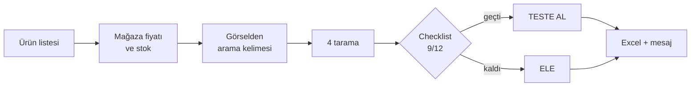

<div align="center">

# Ürün Danışmanı

**Öğrencinin gönderdiği ürün listesini tarayan, puanlayan ve ona doğal bir dille geri bildirim yazan Claude talimatı.**

Tek dosya: [`CLAUDE.md`](CLAUDE.md) · Claude ve ChatGPT ile çalışır · Türkçe

</div>

---

E-ticaret danışmanlığında en çok zaman alan iş, öğrencinin "şu ürünler nasıl?" diye attığı listeye cevap vermektir. Her ürünün fiyatına, rakiplerine ve reklamlarına bakmak, sonra hem motive eden hem de bir şey öğreten bir mesaj yazmak gerekir.

Bu talimat o işi Claude'a yaptırır. Asıl fikir şu:

> Amaç tek bir kesin kazanan bulmak değil, **çok ürün test etmek.**

## Ne yapar

| | |
|---|---|
| 🔎 **Tarar** | Her ürünü 4 kaynakta kontrol eder: AliExpress maliyeti, Facebook reklam kütüphanesi, TikTok/Instagram, Trendyol |
| ✅ **Puanlar** | 12 soruluk checklist. 9 ve üstü EVET çıkarsa ürün **teste** girer |
| 📊 **Excel üretir** | Rehber, checklist, ürün takip, test planı, haftalık gelişim ve örnek sayfaları |
| 💬 **Mesaj yazar** | Danışmanın ağzından, doğal WhatsApp diliyle. Selam yok, emoji yok, yapay zeka kalıbı yok |

## Akış



## Kullanım

**Claude Code**
```bash
git clone https://github.com/armanvibecoding/urun-danisman
cd urun-danisman
claude
```
Sonra ürün listesini (Excel ya da linkler) ver ve "şu listeye bak, danışana mesaj yaz" de.

**ChatGPT / Claude.ai**
[`CLAUDE.md`](CLAUDE.md) dosyasını sohbete ekle, ürün listesini de ekle ve aynı şeyi yaz.

## Checklist

| Kaynak | Soru |
|---|---|
| Ürün | Gerçek bir sorunu çözüyor mu? · İlk 3 saniyede "vay be" dedirtiyor mu? · Sezonu uygun mu? |
| AliExpress | Gerçek ürün var mı? · Satış fiyatı, vergi dahil maliyetin 3 katı mı? |
| Reklam kütüphanesi | Yeni reklam var mı? · 1 aydan uzun açık reklam var mı? · Reklamcı sayısı makul mü? |
| Sosyal medya | Son 3 ayda 100 bin+ izlenen video var mı? · "Nereden alırım" diyen var mı? · Konsept yeni mi? |
| Trendyol | Boş ya da zayıf mı? |

> Eşikler başlangıç değeridir, ölçülmüş değildir. Test sonuçları biriktikçe kendi verine göre değiştir.

## Örnek mesaj

Gerçek bir danışana giden mesajdan bir parça:

```text
listeye baktım eline sağlık. ilk liste için baya iyi olmuş açıkçası, sadece ürün
güzel mi diye bakmamışsın siteye fiyata sezona da kafa yormuşsun. o kafa doğru kafa

ayak masaj aletinde gördüğün 160 dolar ikili paketin fiyatıymış, tekli 89.95

şimdi asıl olay şu. biz tek bi kesin kazanan ürün bulmaya çalışmıyoruz, çok ürün
test etmeye çalışıyoruz. hangi ürün satar kimse önceden bilemez, kazananı bulan da
en çok ürünü en hızlı test eden oluyor
```

## Kurallar

- **Rakam uydurmaz.** Görmediği bir veriyi `Bakılmadı`, bakıp bulamadığını `Yok` diye yazar. Hiçbir hücre boş kalmaz.
- **Hesaba girmez.** Hesap açmaz, giriş yapmaz, sipariş vermez. AliExpress'in ödeme sayfasındaki fiyatı danışan kendisi bakar.
- **Doğal yazar.** Tek ölçütü şu: *gerçek bir danışman bu sohbette bunu böyle yazar mıydı?*

## Lisans

[MIT](LICENSE)
